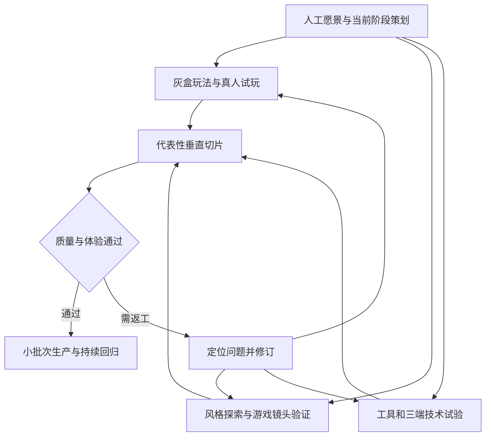

# 人工主导的 AI 游戏制作流程

框架以可运行的成果验证假设，用阶段验收控制投入。人工掌握创意、体验和品质方向；AI 把已确认意图转成规格、任务、源文件和运行成果，再提供可复核证据。流程允许反复迭代，不要求在原型前一次性写完全部游戏。

本项目采用质量优先的小批次方式：不要求一次产出很多，先消除会导致大面积返工的歧义和技术风险，再完成代表性样例。新增的 [前置质量流程](QUALITY_FIRST_WORKFLOW.md) 规定如何执行；[开源研究与取舍](research/OPEN_SOURCE_REVIEW.md) 记录参考来源及不照搬的部分。

以下阶段是为本项目提出的工作方案，不能视为某项能保证成功的科学定律。科学性体现在提出明确问题、控制验证条件、记录观察、根据证据修正，而不是文档数量或流程长度。

## 五层结构

| 层次 | 解决的问题 | 主要产物 |
| --- | --- | --- |
| 人工设计 | 什么体验值得做，什么不能变 | 愿景、体验支柱、当前阶段策划、风格参照 |
| 制作管理 | 谁做什么，依赖什么，做到哪里 | 阶段计划、任务契约、资产数量清单、风险和决策记录 |
| 专业制作 | 用哪些软件把设计做出来 | 引擎工程、美术源文件、脚本、导出设置与构建 |
| 质量验证 | 如何知道符合设计和标准 | 自动检查、独立复核、引擎画面、真机性能、真人试玩 |
| 版本追溯 | 如何重建成果并继续工作 | 版本控制、依赖锁定、证据包、当前状态与交接记录 |

这五层需要共同工作。AGENTS.md 是 AI 的项目入口；可执行检查、独立复核和人工体验判断承担不同的验收职责。

## 阶段与退出条件

| 阶段 | 要解决的主要问题 | 必须有的成果 | 退出条件 |
| --- | --- | --- | --- |
| G0 准备与立项 | 做什么、为谁做、规模和平台是什么 | 项目准备表、体验支柱、参考与反例、风险表 | 当前原型的设计足够明确；未知项有负责人 |
| G1 玩法与技术原型 | 核心循环是否成立，最大风险能否解决 | 灰盒可玩原型、技术试验、并行美术探索 | 真人能实际体验循环；关键假设有结果；PC 与移动端代表输入得到试验 |
| G2 垂直切片 | 最终品质能否用完整管线做出来 | 一段代表性完整玩法，含适用的美术、UI、音效、保存或重试 | 人工认可体验和风格；目标品质与预算达标；三端构建与代表设备风险有证据；可复现 |
| G3 批量生产 | 能否按同样标准稳定扩展 | 分批功能、关卡和资源，持续可玩的集成版本 | 每批按数量清单及相同标准验收，定期回归三端 |
| G4 Alpha | 承诺的主要功能是否全程贯通 | 从开始到结束可运行的主要流程 | 主要功能齐备，剩余内容与缺陷明确，不再掩盖系统性缺口 |
| G5 Beta 与发布候选 | 内容、兼容性、体验与性能是否稳定 | 内容完成的候选构建、设备矩阵、缺陷和试玩记录 | 各平台发布门槛满足；无阻断问题；剩余缺陷按政策处理 |
| G6 发布与维护 | 如何发布、反馈、修复和恢复 | 可重建版本、发布说明、监测与补丁方案 | 用户作出发布决定；版本与问题可以追溯 |

阶段命名采用本项目定义。每个阶段都可以回到前面修订设计，不能因为“已经进入生产”就忽略试玩发现。Ubisoft 的公开流程也将概念原型、前期制作、生产与 Alpha/Beta 等验证阶段分开；这里不照搬其团队规模和全部审批制度。[制作流程参考](https://www.ubisoft.com/en-us/company/how-we-make-games/creative-process)

## 三端验证的时机

- G0 明确 PC 操作系统、移动端横竖屏、输入策略、代表设备与首发顺序。未决定项先记录。
- G1 尽早在代表性移动设备验证核心操作；并行做 PC、iOS、Android 最小构建试验，识别原生插件、渲染及工具链风险。
- G2 用真实代表场景在三端构建并测试，不等到内容量产完再移植。目标设备、内存、帧时间及触控体验纳入切片验收。
- G3 起共享层或平台接口发生重要变更时回归相关平台；设备覆盖随风险扩展。
- G5 完成正式支持矩阵、安装升级、存档迁移、后台恢复、持续运行及发布相关要求。

暂时没有某平台资源时，可以继续不依赖它的研究和制作，但必须标记未验证。若决定先量产再验证该平台，需要用户对具体风险和范围作出决定，不能把缺口默认为已通过。

## 玩法与美术的并行关系



灰盒通过简单形状与临时资源验证玩法。视觉本身决定玩法时，例如依赖颜色或空间识别的机制，应在原型就加入足够真实的视觉条件。灰盒允许简化画面，不允许把未验证的体验称为已成立。

垂直切片是达到目标品质的一小段完整游戏。它既验证玩家体验，也验证制作、导出、导入、构建和验收的整个过程。第一段通过后再用第二个代表性资产或小片段检查流程能否重复，避免只有一个手工修好的展示样例。

## 美术生产分支

### 3D 内容

用途和镜头需求 → 概念与比例参照 → 灰模入引擎验证 → 正式建模 → 适用的拓扑、UV、烘焙 → 贴图与材质 → 适用的骨骼和动画、LOD、碰撞 → 引擎材质与光照整合 → 实际镜头和目标设备验收。

步骤由资产类型决定。简单道具未必需要高模、重拓扑或骨骼；某些材质可用程序方式实现。接口稳定后，动画与部分材质工作可以并行。发生比例、结构或风格问题时回到上游修正，不强行进入下一步。

### 2D 内容

风格与屏幕尺寸 → 分层源稿或像素稿 → 动画及切片 → 图集、枢轴、像素密度和碰撞 → 引擎内缩放、过滤和交互 → 目标设备可读性与性能验收。

2D 项目不强制使用建模流程。工具应服务于所选美术路线。

### 验收对象

每项正式资源要有可编辑源文件、游戏使用的导出件、导入配置和引擎内实例。用实际游戏摄像机、角色比例、光照、运动、遮挡和 UI 叠加检查。离线展示渲染可以帮助评审细节，但最终以游戏运行画面为准。

## 人工与 AI 的职责

| 角色 | 负责 | 边界 |
| --- | --- | --- |
| 人工创意与产品负责人 | 体验、玩法、风格、范围和阶段决定 | 不需要亲自批准每个代码实现细节 |
| 主协调 agent | 计划、任务契约、依赖、文件所有权、集成和状态 | 不把自己的策划建议当作已批准决定 |
| 技术 agent | 架构、代码、平台适配、构建和诊断 | 不自行删除设计需求或降低性能预算 |
| 美术或技术美术 agent | 按规范制作资产、导入与效果校准 | 不用概念图替代可用资产，不隐藏源文件缺口 |
| QA agent | 依据冻结标准独立检查、重跑与报告缺陷 | 默认只读，不重写标准迁就实现 |
| 人类试玩者 | 实际操作与表达感受 | AI 模拟意见不能代替真人观察 |

角色不必长期各占一个 agent。先由主协调者组织少量工作者，按任务需要轮换。并发规模受工具、文件依赖和当前账户能力限制；本轮环境允许同时活动的 agent 数量有限，不能承诺无限并发。

## 每项任务的闭环

1. 引用已确认的设计片段，明确玩家可观察结果。
2. 写出交付物、数量、范围边界、接口、验收条件和文件所有权。
3. 核查输入与工具，达到 READY 后实施。
4. 实施者运行检查，失败就进入 REWORK，修复后重验。
5. 独立复核者检查产物和原始证据；体验、风格或阶段决策交给人工。同批低风险文案或元数据修正可共用一次轻量差异复核，不为每处改动创建单独的 agent 或审批环节。
6. 结论只适用于被验证的版本；集成后再回归受影响内容。
7. 更新任务、缺陷清单和当前状态，保留可恢复版本。

质量验收细则见 [质量门禁](QUALITY_GATES.md)。某个任务需要人为取舍时，AI 应先准备实物或明确方案，使人能够决定；其他已授权且不依赖该取舍的任务继续推进。

## 如何同时控制数量与质量

数量清单用于防止漏交，不是产量考核。验收未完成时不扩大同类内容；探索、试玩与创造性迭代仍然必要，目标是减少可避免的重复劳动。

每个生产批次维护一张资产或功能清单：唯一 ID、用途、变体数量、优先级、依赖、负责人、预期交付、实际交付、验收状态和证据。只有 ACCEPTED 的数量计入完成量。

不能把 10 个半成品算作 10 个完成资产，也不能用一个好看的样例代表整批通过。自动检查可以覆盖命名、引用、导入和预算；视觉与集成复核按已定义的风险策略执行，关键资源逐项检查。数量增减和范围调整写入决策记录。

生产计划依据切片和小批次的真实制作、返工与集成成本估计。时间可放宽意味着允许充分修复，不意味着无限扩大内容范围。

## 返工和升级处理

缺陷记录需要包含对应条件、重现方式、实际与期望差异、影响范围、负责人和修复验证。连续重复失败时，暂停重复同一种办法，先定位根因；必要时更换工具、重做资产、缩小试验或提出人工处理需求。

不得为了继续流转而自行调低标准。若原定标准不可行，AI 应交付差距证据及替代方案，由有决策权的人选择。不能用“已投入很多 token”作为接受理由。

## 文件和上下文管理

建议后续按需要建立以下目录，现在不创建空的游戏工程：

```text
docs/design/        已确认的策划模块与版本
docs/art/           风格规范与黄金样例索引
docs/decisions/     实际决定及出处
tasks/             活跃任务与生产清单
art/source/        可编辑美术源文件
art/export/        给引擎使用的导出件
game/              选定引擎的工程
tools/             已验证的制作与检查脚本
evidence/          与版本绑定的验证记录
builds/            本地构建输出或远端构建索引
```

小型文本使用 Git；大型二进制资源评估 Git LFS 或适合团队的资源版本系统，构建包保存到合适的产物存储。必须能取回对应版本的源文件和依赖，并验证从干净环境构建。未部署的版本控制与备份不能视为已有保障。

任务交给子 agent 时只提供相关设计版本、约束、允许修改的路径、接口和验收条件。主协调者保留任务图与决定，详细日志归档到证据，避免让对话记忆成为唯一事实来源。独立并行任务与只读复核也是官方子 agent 文档明确适合的用途。[协作能力参考](https://learn.chatgpt.com/docs/agent-configuration/subagents)
