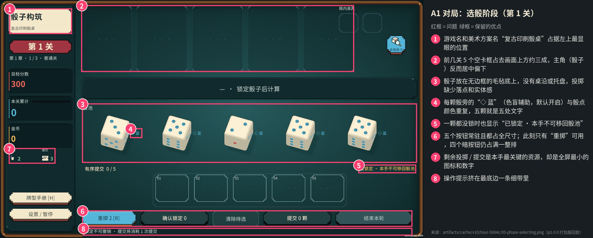
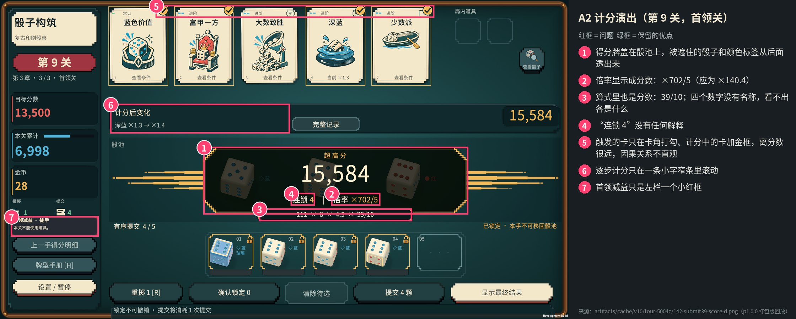
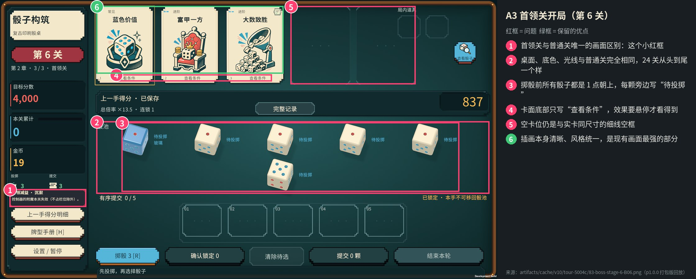
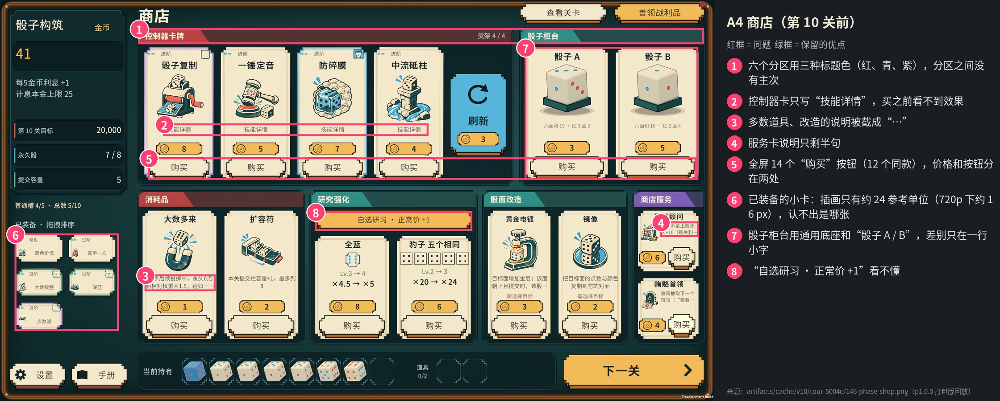
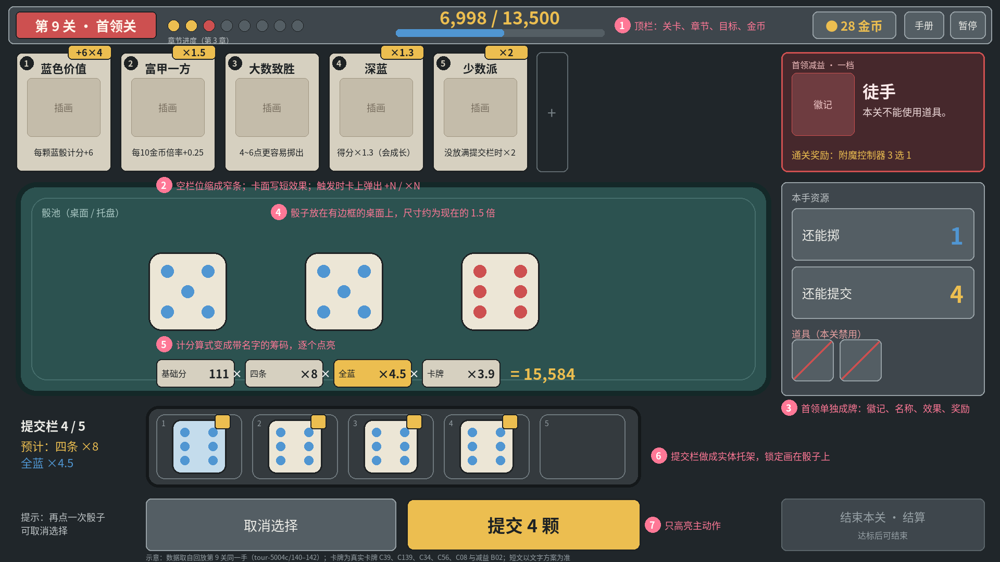
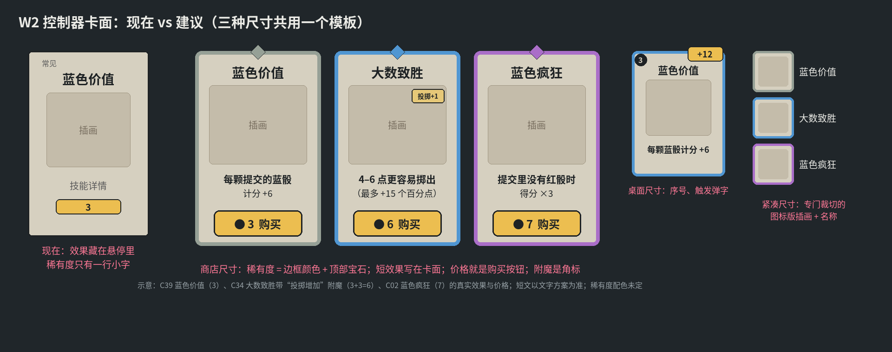
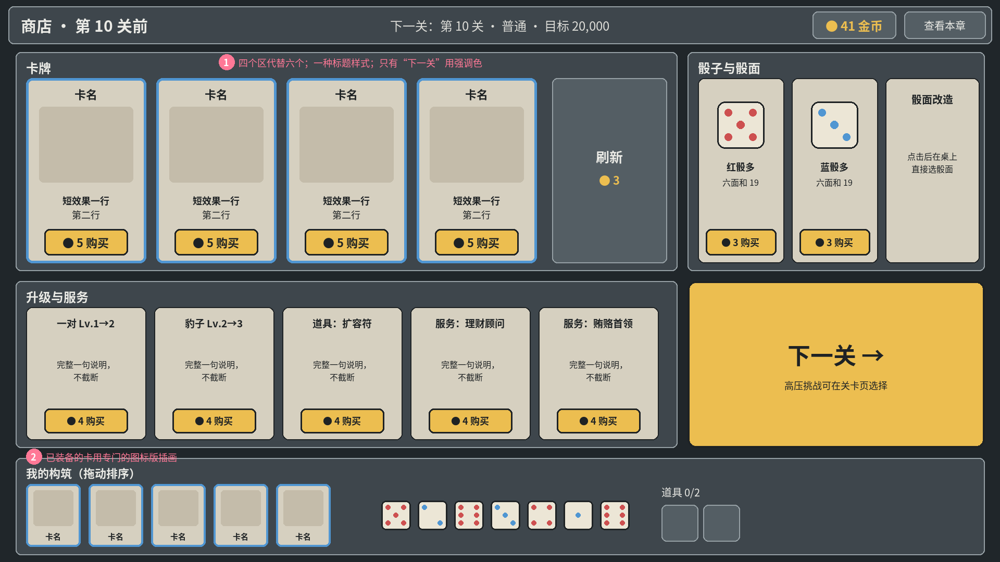

# 美术体验审查与修改方案

状态：**提案**（2026-11-16），未实施，等用户决定。本文不改任何游戏文件。

- 用户要求（2026-11-16）：“审查现有美术方案，反思美术方案对玩家观看和体验的不足之处，提出修改方案和内容。生动、美观、一致地向玩家进行展示。”另要求先设计方案、不立即实施。
- 依据：
  - p1.0.0 打包版的回放截图 `artifacts/cache/v10/tour-5004c/`（种子 5004，173 张），实际看了其中 16 张代表画面；
  - [风格总纲](../art/STYLE_GUIDE.md) 1.1；
  - v1.0 插画复核 `evidence/v10/art/ART_REVIEW_R1.md`；
  - 2026-11-15 的 20 套方向概念板 `ArtSource/AIConcepts/2026-11-15-style-exploration/`。
- 没看：手册、设置、新手引导、1280×720 实机、Mac。回放里没有这些画面，本文对它们不下结论。
- 配套的[玩家文字审查方案](2026-11-16-text-readability.md)处理文字本身；本文只在版式需要时提到文字。
- 同日的两项相关工作，本文没有据以下结论：
  - 另一份报告 [PLAYTEST_REPORT](../specs/v10/PLAYTEST_REPORT.md) 第 8 节看了种子 5005 的整局回放，记录了几点与本文一致的观察：R7 通关画面没有庆祝演出；R8 已装备的控制器到 7 张时在商店左栏就显示不下，要滚动；R6 首领减益说明框字号全屏最小。
  - 20 个方向各扩展了 4 张实机场景概念图，见 `ArtSource/AIConcepts/2026-11-16-scene-exploration/`。本文写作时没有看过，选方向时应与 §6 一起看。

## 0 结论

单个资源的质量不错：184 张插画风格统一、画面清晰；Blender 骰子干净；主菜单字标有辨识度。问题出在这些资源组成的**画面**上。按对玩家的影响排序：

1. **骰子不是主角。** 骰子放在一片无边框的毛毡底上，占画面的比例小。前几关屏幕上方约三成是空卡框，左上角放的是游戏名和美术方案名。
2. **计分的因果看不见。** 哪颗骰子、哪张卡贡献了多少，只能从一条小字窄条和卡角的小勾去读。倍率还显示成分数（×702/5）。计分牌也会盖住骰池。
3. **没有起伏。** 24 关用同一张桌子、同一种光线。首领关只比普通关多一个小红框。打赢首领时，结算虽有金币飞入，主画面仍是一张会计账单，和普通关没有区别。
4. **效果藏起来了。** 卡面写的是“技能详情”“查看条件”，效果要悬停才能看到。道具和服务的说明被截断。
5. **几种造型语言混在一起。** 界面是带像素味的阶梯切角，插画是圆润的印刷风，骰子是平滑 3D，资源小图标是色块拼的。商店的 6 个分区用了 3 种标题色，全屏有 14 个“购买”按钮。

方案分三层：

- **A 布局与层级**：与选哪种风格无关，建议先做。
- **B 反馈与起伏**：新增演出，以及少量新资源。
- **C 统一造型语言**：跟随用户从 20 套方向里的选择。

建议顺序：先把**对局画面**做成一个灰盒黄金样例，在实机上验证 A 和 B 的核心部分；用户看过以后再定皮肤，然后推广到其他画面。

## 1 证据：标注截图

红框是问题，绿框是要保留的优点。每张图右侧有逐条说明。

| 图 | 画面 |
| --- | --- |
| [A1](img/2026-11-16-art/A1-05-phase-selecting.jpg) | 对局，选骰阶段 |
| [A2](img/2026-11-16-art/A2-142-submit39-score-d.jpg) | 计分演出（第 9 关） |
| [A3](img/2026-11-16-art/A3-83-boss-stage-6-B06.jpg) | 首领关开局（第 6 关） |
| [A4](img/2026-11-16-art/A4-146-phase-shop.jpg) | 商店 |
| [A5](img/2026-11-16-art/A5-145-phase-stagesettlement.jpg) | 关卡结算 |
| [A6](img/2026-11-16-art/A6-54-shop-gifts-L3.jpg) | 首领战利品 |
| [A7](img/2026-11-16-art/A7-00-menu.jpg) | 主菜单 |

## 2 问题清单

| ID | 问题 | 证据 | 对玩家的影响 |
| --- | --- | --- | --- |
| V1 | 骰池是无边框的毛毡底，没有桌沿或托盘；骰子开局约 130 参考单位宽，超过 5 颗时约 105–115（`Art07.cs:259` 按骰数缩放），占画面比例小 | A1-3、A3-2 | 掷骰缺少落点和重量感，最核心的动作最没有存在感 |
| V2 | 空控制器位是与实卡同尺寸的细线空框（`Art07.cs:153-159`），前几关上方约三成是空框 | A1-2、A3-5 | 画面重心在空白上 |
| V3 | 计分步骤只在一条小字窄条里显示；触发的卡只在卡角打勾、正在计分的卡加金框，都离分数很远；分数算式是四个没有名字的数 | A2-3、A2-5、A2-6 | 玩家不知道自己的构筑为什么得分，这正是构筑游戏最该放大的乐趣 |
| V4 | 计分牌盖在骰池上，后面变暗的骰子和颜色标签透出来 | A2-1；总纲 §8.5 在 v0.8 已观察到，v1.0 仍在 | 刚提交的骰子在最关键的一刻被遮住 |
| V5 | 首领关只多一个小红框，桌面、光线与普通关相同（部分减益另有“封印”提交格和“本关失效”卡片标记）；高压关在局内只有左栏一行“高压挑战”小字（`tour-5004c/28-phase-handready.png`） | A3-1、A3-2 | v1.0 的核心新机制没有存在感，难度起伏感受不到 |
| V5b | 新一关开始时，计分栏仍显示上一关最后一手的得分（“上一手得分 · 已保存 312”） | `tour-5004c/28-phase-handready.png` | 开局第一眼看到的是旧数字 |
| V6 | 24 关、8 章的画面完全相同 | A3-2 | 进度推进没有视觉回报 |
| V7 | 卡面底部写“技能详情”或“查看条件”，效果要悬停才看得到 | A3-4、A4-2 | 选卡、排序都要逐张悬停，商店决策慢 |
| V8 | 多数道具、服务、骰面改造的说明被截成“…”（146 号截图里大数多来、黄金电镀、理财顾问、贿赂首领被截断，扩容符、镜像完整） | A4-3、A4-4 | 信息不全，只能猜 |
| V9 | 五个行动按钮常驻且都占全尺寸（宽 250–350 参考单位），不可用的变暗但仍占一整排；可用按钮的颜色随动作不同（蓝、金、纸色），有时两个同时高亮。商店 6 个分区用 3 种标题色，全屏 14 个“购买”按钮（12 个同款） | A1-6、A4-1、A4-5 | 主次靠颜色区分，没有固定的主按钮位置；商店画面嘈杂 |
| V10 | 关卡结算已有金币飞入动画和“跳过演出”（`Art07SettlementReveal.cs`），但主画面是一张账单，首领通关与普通通关看起来一样；战利品面板约一半是空的，“牌型精研”“特制骰子”两组没有插画或图示，没选的写“已作废” | A5、A6 | 奖励时刻的奖励感弱，“已作废”还带一点惩罚感 |
| V11 | 商店里已装备的小卡，插画只有约 24 参考单位（720p 下约 16 px，`Art073Shop.cs:337`），认不出是哪张；对局内小卡是 48 或 64 单位 | A4-6；STATE 遗留“64 px 以下插画图标的锯齿” | 只能靠读卡名 |
| V12 | 每颗骰子旁写“◇ 蓝”“● 红”（“红圆 / 蓝菱辅助”，默认开启）和“待投掷”；掷骰前所有骰子都是 1 点朝上 | A1-4、A3-3 | 五颗骰子就有五处文字；开局画面单调 |
| V13 | 界面阶梯切角、印刷插画、3D 骰子、色块小图标四种造型并存 | 总纲 §8.1、§8.2 | 看起来像不同来源拼成的画面 |
| V14 | 开发信息出现在玩家画面：菜单的版本与构建号、左上的“复古印刷骰桌”、右下角的 Development Build 水印 | A7-1、A1-1 | 不像成品 |
| V15 | 没有存档时“继续对局”已禁用（`Art071Screens.cs:51-52`），“新建挑战”已是蓝色主按钮；但禁用的深色大块在纸色面板上视觉最重 | A7-2、A7-3 | 第一眼的视线落在一个点不了的按钮上（轻微） |

右下角的 Development Build 水印：回放用的是 rc 打包件。正式发行是否换成非开发构建，需要按交付流程另行确认，本文不下结论。

## 3 建议写进风格总纲的“玩家视角”原则

1. **骰子是主角。** 骰池占屏幕中央最大的一块；任何阶段骰子都不被遮挡，计分演出放在骰池上沿或提交栏上方。
2. **一屏一个主动作。** 当前阶段只有一个强调色按钮；其余按钮降一级。
3. **因果同处。** 贡献在哪里产生，数字就在哪里弹出（骰子上方 +N，卡牌上方 ×N），再汇总到一行算式。
4. **有起伏。** 普通、高压、首领三档画面不同；8 章逐步变化；奖励时刻有专属演出。
5. **效果写在卡面上。** 卡面写短效果，细则放在详情里；不截断。
6. **一种造型语言。** 界面件、图标、插画框、特效共用一套角、线、投影规则。
7. **720p 能读。** 正文不小于 20 参考单位（1280×720 下约 13 px），关键数字不小于 32 参考单位。

## 4 方案 A：布局与层级（与风格无关）

下面三张图都是灰盒示意：用的是现行色板，只表达位置、大小和主次，不代表最终外观。卡名、效果和价格取自真实卡牌，短文以文字方案为准。W1 的全部数字取自回放第 9 关的同一手（`tour-5004c/140`–`142`）：基础分 111 × 四条 ×8 × 全蓝 ×4.5 × 卡牌 ×3.9（少数派 ×2、深蓝 ×1.3、富甲一方 ×1.5）= 15,584。

### A1 对局画面

| 区域 | 现在 | 建议 |
| --- | --- | --- |
| 顶栏 | 左上是游戏名和美术方案名；目标、累计、金币是左栏三个大方块 | 一条顶栏：关卡与类型标签、8 章进度点、目标进度条（837 / 4,000）、金币、手册、暂停 |
| 控制器栏 | 5 个全尺寸卡位，空位是与实卡同尺寸的细线空框 | 已有的卡全尺寸显示，左上角带序号；空位缩成带“+”的窄条；卡面写短效果 |
| 首领与本关牌 | 首领减益是左栏的小红框 | 右上独立一张“本关牌”：首领关显示徽记、名称、效果与通关奖励；普通关和高压关显示目标与奖励 |
| 骰池 | 无边框毛毡底；骰子开局约 130 参考单位，骰子多时更小 | 带边框的桌面或托盘；骰子约放大到 1.5 倍；骰旁的颜色文字改成骰子上的小形状角标。“红圆 / 蓝菱辅助”现在默认开启，是否改默认值属于体验决定 |
| 资源 | 投掷、提交是左栏最小的图标和数字 | 右栏两块大数字：掷骰 2 / 3、提交 3；下面是道具格 |
| 提交栏 | 5 个细线空格，编号 01–05 | 实体托架；锁定直接画在骰子上（现有锁图标）；预计牌型挂在托架旁（复用现有“锁定骰子后计算”这一栏的内容） |
| 行动 | 五个按钮常驻全尺寸，可用的颜色各异，不可用的变暗仍占位 | 固定位置一个主按钮，随阶段变成“掷骰 / 锁定 N 颗 / 提交 N 颗”；“取消选择”作次要按钮；“结束本关 · 结算”放在右下，没达标时写“达标后可结束” |

现有引导写着“再点一次可取消”（`Art07Guide.cs:55-56`），即逐颗取消已经可以做到，“清除待选”只是一次全部取消，可以降为小号次要按钮。新文字统一为“取消选择”（文字方案 §2.1）。

### A2 卡面模板

- **稀有度**：现在只在左上角有一行“常见 / 进阶”小字。建议改成边框颜色加顶部宝石，与卡名无关、一眼可辨。配色需要用户决定（总纲 §2 第 3 条：新增色相要用户决定；商店现在已经用了紫色）。
- **短效果**：写在卡面。现在显示“技能详情”“查看条件”的位置，改成文字方案里的卡面短文。成长值、当前倍率作为角标数字。
- **价格**：价格就是购买按钮，不再价签和按钮分开。附魔放在插画角标里。
- **三种尺寸共用一个模板**：
  - 商店尺寸；
  - 桌面尺寸（序号、触发弹字）；
  - 紧凑尺寸，用**专门裁切的图标版插画**（V11），不是把整张插画缩小。

### A3 商店

- 六个分区合并成四个：卡牌、骰子与骰面、升级与服务、我的构筑。统一一种标题样式，只有“下一关”用强调色。
- 顶栏显示下一关的类型与目标，代替左栏的重复信息。
- 骰子柜台不再叫“骰子 A / B”。用骰子本身的特征作标题（例如红面多、六面点数和），细节放在悬停里。
- 骰面改造：买下后直接在桌上的骰子上选面。现在是另开一个骰库式窗口，还要读 D001、F01/F06 这样的编号。

### A4 结算、战利品、主菜单

- **关卡结算**：保留现有的金币飞入和“跳过演出”，把主画面从账单改成通关画面：汇总成大号“+13 金币”，明细默认折叠；首领关通关时换成首领专属版式，并先亮出战利品牌。
- **战利品**：用卡面模板；“牌型精研”“特制骰子”两组补上插画或牌型、骰子图示。选中的那张飞入，其余淡出，不写“已作废”；面板按内容收紧。
- **主菜单**：
  - 版本与构建号只在“版本与构建”页显示；
  - 没有存档时隐藏已禁用的“继续对局”，免得深色禁用块抢视线；“新建挑战”已是蓝色主按钮，保留；
  - 去掉规则提示；
  - 保留字标和插画卡加骰子的组合，扩成主视觉（A7 的绿框）。

## 5 方案 B：反馈与起伏

### B1 计分演出（最优先）

建议顺序：

1. 骰子逐颗弹出计分 +N；
2. 牌型名落在提交栏上方；
3. 触发的卡按顺序弹起，卡上方显示 +N 或 ×N；
4. 下方一行带名字的算式筹码逐个点亮（基础分 111 × 四条 ×8 × 全蓝 ×4.5 × 卡牌 ×3.9 = 15,584）；
5. 总分滚进顶栏的进度条。

- 计分牌不再盖住骰池。“超高分”这类档位用顶栏与桌沿的光效表达。
- 沿用现有的“快速”与“减少动态”设置（`presentation.rollSeconds` 0.9 / `fastRollSeconds` 0.15）。
- 数字一律用小数，不用分数（文字方案 §格式）。
- “连锁 N”要么在算式里有名字，要么去掉，以文字审查对其含义的核对为准。

### B2 首领、高压与章节

- **首领徽记**：39 个首领减益按效果分成 6 族，每族一张徽记插画。具体条件（奇数、偶数、红、蓝、1–3、4–6、第一颗、隔位）由引擎叠加骰点符号表达，不烘焙进插画（总纲 §2 第 2 条）。外面再套一个档位边框（一档、二档、三档、终局）。

  | 族 | 减益 | 数量 |
  | --- | --- | --- |
  | 封印 | B05、B13–B18、B38 | 8 |
  | 提交约束与资源（满员、投掷、提交、栏位、道具） | B01、B02、B09、B10、B27、B32、B33、B34 | 8 |
  | 压制倍率（牌型、颜色、等级、基础分） | B08、B19–B24、B28、B35、B36、B39 | 11 |
  | 压制控制器（失效、附魔、成长） | B06、B07、B25、B29、B37 | 5 |
  | 经济 | B03、B04、B12 | 3 |
  | 目标与得分 | B11、B26、B30、B31 | 4 |

  按主效果归族，39 个各属一族。有两个跨族：B35 返璞归真还会把成长值清零，B38 隔行封印还会让牌型倍率减半；它们的徽记按主效果画，次效果由引擎叠加的符号表达。合计 6 张插画；如果终局另做一张，就是 7 张。
- **首领关桌面**：毛毡压暗，桌沿换成红边，加暗角。入关时首领牌从桌边推入，并盖一个章。
- **高压关**：桌沿加红色细线，目标数字用红色。接受高压时，关卡牌上现有的“高压”印章做成盖章动画。
- **章节**：8 章的桌面明度或色温逐章变化，不改色板角色；顶栏有章节进度点。

### B3 奖励时刻

通关、首领战利品、买卡、骰面改造各需要一个可感知的瞬间：

- 通关：硬币飞入，金币数字滚动；
- 战利品：卡牌翻开；
- 买卡：卡飞入控制器栏；
- 骰面改造：骰子在桌上翻到被改的那一面并闪一下。

已有的：结算金币飞入与“跳过演出”（`Art07SettlementReveal`）、交易动效（`Art07TransactionMotion`）、骰面翻面（`Art07UpgradeSurface`）。实施前先逐项核对这些现状，只补缺的；首领通关和战利品目前没有专属演出。

### B4 掷骰前

骰子在桌边随机朝向地堆着，或放在骰杯里，不再全部 1 点朝上；去掉“待投掷”文字，用稍暗的色调表示还没掷。

### B5 声音

本次没有审查音效。首领入场、战利品、通关需要专属音效，STATE 已列为遗留。

## 6 方案 C：统一造型语言（等用户定方向）

1. **现状**：总纲 §8.1 记录了界面阶梯切角与插画、骰子是两种造型语言，v0.73 的界面风格用户还没判定；§8.2 记录了两套图标并存。商店 6 个分区用了 3 种标题色。
2. **不论选哪个方向都要统一的**：一种角型、一种线宽、一种投影；一个图标族；按钮只分两级；标题只有一种样式；强调色只给主动作和奖励。
3. **与 20 套方向的关系**：这些方向板的版式其实已经共同指向方案 A：骰子放在实体托盘里、大号的“分数 / 目标”、左侧图标列、提交栏带锁。选方向时，建议在审美之外再加四条玩家视角的筛选：
   - 红蓝骰点在 64 px、在桌面底上是否清楚；
   - 正文在面板底上的对比度（WCAG 4.5:1）；
   - 桌面纹理会不会和骰子、文字抢视线；
   - 现有 184 张插画能否保留。若换方向要重画，按每张约 1% 的 Codex 周额度算，至少要两周的额度。

   只看缩略图的初步观察（没有实机验证，只是可读性角度，不是审美判断）：01 瑞士现代主义、06 白纸浮雕、10 航天器搪瓷、17 蓝晒工程图底面干净，可读性风险低；07 留白水墨、09 深海生物荧光、18 拜占庭微型马赛克、19 迷幻流体海报的桌面纹理或暗底会和骰点、文字争抢，风险高。
4. **如果保留现在的印刷插画方向**：建议界面件从阶梯切角改成和插画一致的“印刷卡纸”，即单级 45° 切角或小圆角、墨线、右下硬投影，阴影里加网点；资源图标统一成与插画同族的平涂墨线图标。是否采纳由用户决定（总纲 §8.1）。

## 7 需要新增或改制的美术内容

| 内容 | 数量 | 制作路线 | 依赖 | 优先级 |
| --- | --- | --- | --- | --- |
| 对局画面灰盒黄金样例 | 1 个画面 | Unity 布局 | 用户同意先做 | P0 |
| 计分筹码与弹字组件 | 1 套 | 脚本矢量与引擎 | A1 布局 | P0 |
| 卡面模板（3 尺寸 × 稀有度 3，附魔角标 5 种） | 1 套 | 脚本矢量 | 文字方案的短文；稀有度配色 | P0 |
| 紧凑尺寸的图标版插画 | 184 | 从现有插画裁切、简化；裁不好的用 GPT 编辑（走 artgen 流程） | 卡面模板 | P1 |
| 桌面托盘与桌沿（普通 / 高压 / 首领，加 8 章色调参数） | 1 母版 + 参数 | 矢量或 Blender | 方向 | P1 |
| 首领徽记 | 6（+1 终局） | GPT 插画，走 artgen 流程，从代表件开始 | 锚点确认 | P1 |
| 档位边框 | 4 | 脚本矢量 | 卡面模板 | P1 |
| 资源图标族（掷骰、提交、金币、利息、道具、章节、高压、首领等，约 12 个） | 约 12 | 脚本矢量 | 方向 | P1 |
| 战利品种类图 | 6 | GPT 插画 | 锚点确认 | P2 |
| 结算、战利品、首领入场演出 | 3 段 | 引擎动效 | A1、A4 | P2 |
| 主菜单主视觉 | 1 | GPT 概念 + 引擎组合 | 方向 | P2 |

GPT 插画合计约 13 张。按现有记录约占 13% 的 Codex 周额度；这个估算只有一次取整后的观测（77% → 78%）作依据，误差大。

## 8 实施顺序与验收建议

1. 用户就 §10 作决定。
2. 黄金样例：对局画面（A1 加 B1）。在 1920×1080 与 1280×720 实机截图，由用户过目。这一步会改 Unity 布局代码；现有 PlayMode 测试里有很多固定控件位置和尺寸的断言，需要逐项改写（不删测试、不降阈值）。
3. 通过后推广到商店、结算、战利品、菜单（A2–A4）。
4. 方向定下来以后统一皮肤（C）。
5. 新插画按 [AI_ART_PIPELINE](../art/AI_ART_PIPELINE.md) 先做代表件，再分小批。

建议的验收条件（任务化时再编号、补方法和证据）：

| 建议 ID | 条件 |
| --- | --- |
| AX-01 | 计分演出的每一帧，提交的骰子都不被遮挡（逐帧截图检查） |
| AX-02 | 每个阶段只有一个强调色按钮 |
| AX-03 | 1280×720 下正文 ≥ 13 px、关键数字 ≥ 21 px；全部卡牌、道具、服务的卡面短文完整显示，不截断 |
| AX-04 | 把截图缩到 25%，首领关与普通关仍能区分（由没看过的人判断） |
| AX-05 | 计分时每个贡献来源都在来源处有可见弹字 |
| AX-06 | 玩家画面不出现内部编号、分数形式的倍率和版本号（“版本与构建”页除外） |
| AX-07 | 紧凑尺寸下同屏的卡两两可以区分 |

体验与美术标杆由用户签署。

## 9 独立复核（2026-11-16，只读子任务）

复核者核对了第 2 节每一条事实，以及灰盒图里的卡牌数据。27 条中 17 条正确、9 条有误、1 条无法判断（“实际看了 16 张”无从复核）。两个结论都是“有缺陷”：错在前提，核心判断没有被推翻。

已按复核意见改正：

- 行动按钮（V9）：五个按钮宽度不同，可用的各有颜色，并非“分量相同”；商店是 14 个“购买”、3 种标题色。
- 主菜单（V15）：没有存档时“继续对局”已禁用，“新建挑战”已是主按钮。
- 结算（V10）：已有金币飞入动画；战利品面板约一半空，只有两组没有插画。
- 小卡插画（V11）：实际是 24 参考单位，比原文写的更小。
- 措辞：V1、V2 的“纯色底”“虚线框”不准确，已改；V12 的颜色标签是默认开启的设置项。
- 计分演示：“三条 ×8”不可能出现，那一手是四条。W1 原先混用了两关的数据，已整张换成第 9 关同一手的真实数据。
- 价格：W2 里一个不可能出现的附魔价格（5）已改为 6。
- 首领分族：B06、B07 不是“控制器失效”，B01 不是“减资源”，已改族名。
- 额度估算：已注明只有一次观测。

复核确认成立的核心判断：骰子不是主角；计分因果看不见；首领关和高压关没有存在感；开发信息外露；184 张插画。修正后没有再请复核者复查。

## 10 需要用户决定

1. 是否先做对局画面的灰盒黄金样例（推荐）。
2. 美术方向：从 20 套里选一个；或者保留现在的印刷插画方向，并决定界面阶梯切角是否改成印刷卡纸。
3. 首领徽记按 6 族做（推荐，约 7 张），还是 39 个减益各一张。
4. 是否用桌面色调表达章节推进。
5. 操作方式的改动边界：主按钮随阶段变化、“清除待选”降级、骰面改造改为在桌上选面。这些都不改规则，但属于体验决定。
6. 稀有度的配色。
