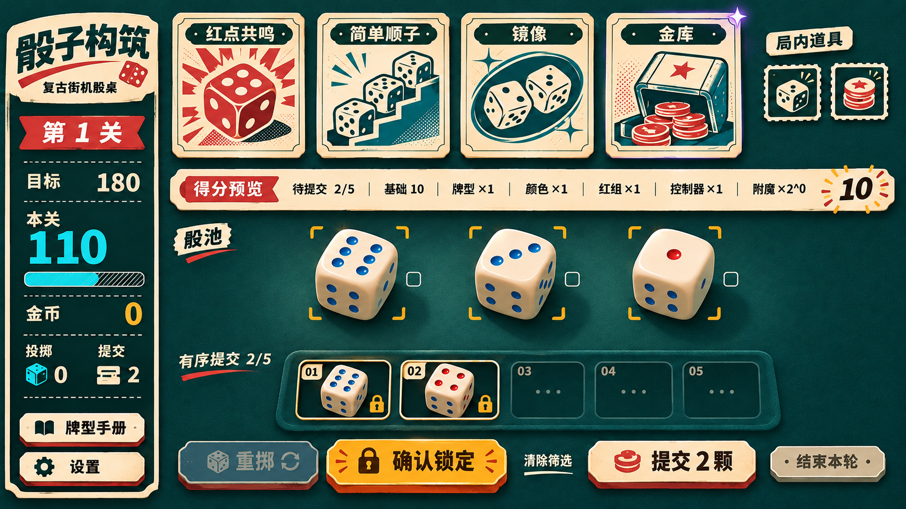
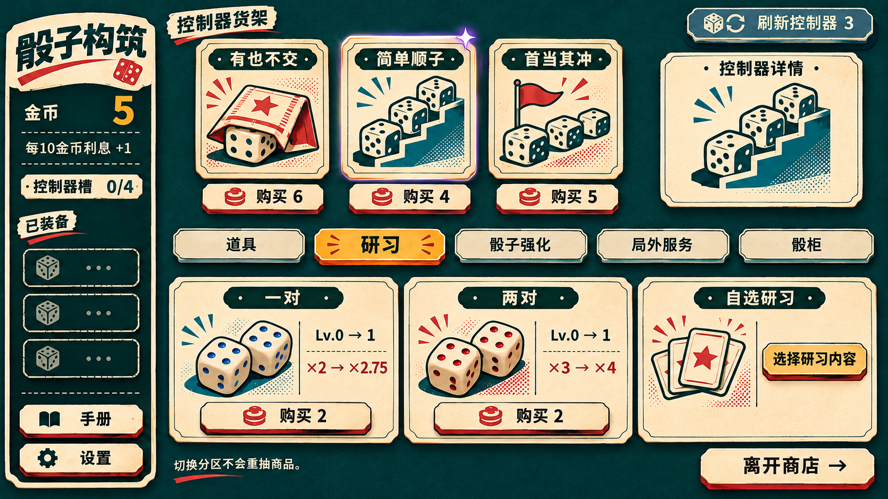
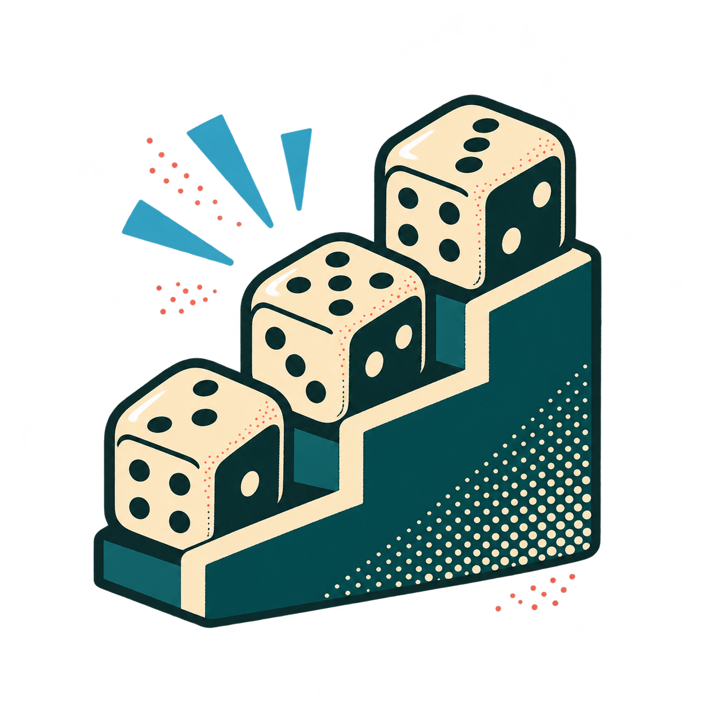

# 骰子构筑游戏 v0.71 美术开发改进方案

版本：v0.71　表现配置建议：art0.7.1　日期：2026年11月8日  
实施环境：Unity 6.6、Blender 5.2　适用团队：个人或三人以内，AI 辅助制作  
接续：v0.7 美术方案与现有 p0.6.0 玩法，存档结构沿用 schema 4

本版采用“对局视觉母版 → 小套真实素材 → Unity 美术样板 → 共用组件扩展页面”的开发顺序。先把一张卡、一颗骰子、一组按钮做成可复用的成品，再扩展数量。风格统一由相同图片、模型、材质和组件保证，少量对照用于修正偏差。

核心方向定为复古印刷骰桌：深青毛毡、奶油纸卡、大轮廓限色插画、温润陶瓷骰子与清楚的中文排版。v0.71 将 v0.7 的“有限色像素插图”收敛为更易稳定生产的高清限色印刷插画；像素感仅保留在少量颗粒和装饰中。整屏保持清晰，三维骰子与二维 UI 用同一配色、光源方向及阴影关系连接。

## 01 本次修订要解决什么

### 从七张实机截图看到的差距

现有画面已经具备深青、奶油、红蓝和金色的基本关系，功能分区也能理解。美术不足主要集中在主题资产和层次：大量矩形框承担了本应由插画、纸张、骰桌与光照承担的工作。控制器画面中的加号、几段台阶线或小方块能表达功能，却不足以形成玩家想收藏的卡面。

| 实机界面 | 可见差距 | v0.71 的直接改法 |
|---|---|---|
| 主菜单 | 标题、卡背与骰子分别排列，视觉联系弱；右侧框体较重 | 组合成一组有重叠关系的骰子与卡牌静物；标题做专用字标；菜单保留清楚的主次 |
| 初始对局 | 空卡槽、空计分区占据大量空间；骰子与背景接触感弱 | 空槽改为低对比压印；计分区压薄；骰子增加统一接触阴影 |
| 选择与锁定 | 计算因子像按钮；骰子旁有多组状态文字 | 因子改为平面标签；选择用角标，锁定用实心锁章；说明集中显示 |
| 牌型手册 | 每行都采用厚按钮造型，阅读层次接近 | 改成规则册列表，示例、名称、倍率固定对齐；选中行才强调 |
| 商店研习 | 卡面主体太小；三件商品占满一个大货架，右侧空旷 | 放大插画；常态三件商品与右侧详情协同排布，满货架时详情收起 |
| 商店道具 | 小图标难以形成主题；效果描述截断；缺钱提示重复 | 制作完整道具插画；详情完整展示；购买状态合并到动作附近 |
| 选关 | 挑战框主要靠文字与边框区分；24 个节点同权 | 用印刷契约卡与风险章；按章节组织进度，当前章节突出 |

这些结论来自静态截图。投掷、卡牌触发与计分动画的实际节奏需要后续在引擎中观看。选关图右下的截图缩略浮层不属于游戏 UI，开发构建水印也不作为美术缺陷。

### v0.7 到 v0.71 的执行差异

| 项目 | v0.71 的调整 |
|---|---|
| 风格输入 | 每个任务携带同一张母版与对应组件参考，减少仅凭文字重新理解风格 |
| 制作顺序 | 先做素材和可交互样板，再迁移页面，再批量扩展内容 |
| 卡面 | 主体插画成为主要视觉；小图标用于标签和状态 |
| 界面布局 | 保留功能位置，调整内容密度；不按最大容量永久预留高对比空框 |
| 组件实现 | 相同用途使用相同 Prefab、字体样式和主题配置 |
| 动效 | 六类共用动作与同一套计分演出，卡牌主要提供目标与颜色参数 |
| 反馈方法 | 三个自然对照点，每次解决最显眼的三处差距 |

v0.71 覆盖 v0.7 中与本稿冲突的视觉媒介、布局、组件样式与制作顺序。原有物品 ID、技能效果、价格、牌型强化、关卡目标、抽样和存档数据继续使用既有配置。这里不重列 71 项玩法内容，也不以效果图里的文字反推规则。

## 02 视觉母版及其使用方式

本次提供一张对局母版、一张由该母版衍生的商店图，以及一张无文字、带透明通道的控制器插画样件。它们用于明确目标并演示素材拆分方法。真正开发时，Unity 美术样板中的实际材质、文字和组件成为后续页面的复用依据。

对局母版重点：大幅主题插画、浅纸色与深桌面的对比、陶瓷骰子的柔和高光与接触阴影、薄计分带、明确的主动作。图中的卡名与数值为构图示意；不得据此新增控制器或改动结算。待选勾、禁用状态和锁定标记应绑定真实状态。

商店衍生图重点：沿用同一卡纸、插画、按钮与桌布；让三件商品与右侧详情填充空间。正式界面的可购买状态、稀有度、附魔、装备数量与牌型示例仍由现有配置生成。研习图中的装饰骰子不是精确牌型图，精确示例使用程序排布。

透明插画样件用于演示“效果图中的风格成为实际素材”。样件不带卡框、卡名或价格，可置入同一卡牌组件。它尚未在用户的 Unity 工程中导入验证；只作主题插画，不能替代真实点数、牌型或控制器数据。

### 三种文件各司其职

1. 母版图回答“整体应该呈现什么样子”：构图、材质、明暗、插画密度和主次。
2. 素材包回答“画面由什么组成”：独立插画、可复用卡框、按钮表面、桌布、模型和材质。
3. 引擎组件回答“它如何工作”：真实文字、动态数值、布局、交互与动画。

完整效果图不作为一个覆盖全屏的 UI 背景，也不从中连文字和阴影一起截图充当按钮。装饰插画与规则信息分开制作，后续改价格、语言或卡名时不需要重新生成图片。

## 03 改进后的开发流程

### 第一步 选一个覆盖核心对象的对局状态

使用三张已装备控制器、一个空槽、三颗骰池骰子（其中一颗待选）、两颗已锁骰子，共五颗骰子，以及可见得分条制作样板。该状态覆盖卡面、空槽、3D 材质、锁定、动作按钮及计分。主菜单在后面制作，它可以复用骰子和卡牌，但无法独立约束对局的复杂度。

现有工程读取数据来填充样板；美术场景中的演示数据使用独立预设，不写入正式存档。具备真实规则的对局页与只供展示的 ArtStyleLab 要标明用途，避免演示按钮被误接到正式购买或结算。

### 第二步 把母版拆成一套小型素材

先制作第 08 节的 18 项生产任务。它们覆盖桌布、卡框、按钮、三张代表控制器插画、一张道具插画、一颗骰子和共用特效。先让可见的核心对象完整，再逐批扩展。已能工作的旧图标可留给二级入口，控制器主体使用新插画。

九宫格边框、点阵、几何图标等尺寸明确的资源由确定性绘制或矢量源文件生成；主题插画、纸纹与织物适合参考图生成。两条路径共同遵守色板和边缘风格。这样，AI 把创作能力用在内容上，边框尺寸和点数保持准确。

### 第三步 在 Unity 中完成美术样板

新建一个用于预览的 ArtStyleLab 场景，或者复用已有开发展示场景。放入真实素材、真实文字、一颗实时 3D 骰子、一张控制器及其附魔、一组按钮和一次触发。随后用相同组件搭出对局母版状态。

默认保留工程既有的 UI 框架和渲染管线。若工程使用 uGUI，使用 Canvas、TextMeshPro 与既有 Prefab；若已使用 UI Toolkit，沿用其组件方式，不为了换美术重做整个 UI 技术栈。官方 Unity 指南也建议在请求中明确已有 UI 框架。[S2]

样板的调节集中在材质、光照、图像尺寸、字体层次和空白分布。若卡面仍是小符号，应继续补插画；若骰子显得悬浮，应调整接触阴影。优先解决具体视觉原因。

### 第四步 用同一套组件迁移界面

迁移顺序为对局、商店、手册与详情、选关、结算、主菜单、设置。页面负责组织信息，卡框、按钮、标题、状态、说明文字与动作由共用组件提供。尽量保留原事件绑定，只替换表现层和必要的布局容器。

### 第五步 按小批次补齐内容

控制器每批 4—6 张，始终携带同一母版、同一插画样件和同一裁切比例。先完成截图中已经出现的“有也不交”“简单顺子”“首当其冲”，再按既有物品 ID 补齐其余内容。开发 AI 必须从工程配置读取对应 ID，名称不能作为永久索引。

风格由一名负责人统一维护。多人或多代理可以并行制作主题插画、骰子模型与 UI 接入，但不能分别为主菜单、商店和对局建立不同的色板和卡框。

## 04 Skills 与工具的选择

Skill 提供任务方法，连接工具提供编辑器操作能力，图片和组件提供视觉一致性。三者需要分工使用。本稿推荐已有能力，不要求另做一个复杂的自定义技能系统。

| 能力 | 本版使用方式 | 使用条件 |
|---|---|---|
| OpenAI imagegen | 生成对局母版，引用母版做衍生图，单独生成透明插画 | 本会话已用；开发端按实际可用工具执行 |
| unity:ui | 识别当前 UI 框架并路由到对应技能 | 在修改工程前读已有场景与文件 |
| unity:ui-ugui | 修改 Canvas、锚点、布局和可复用 Prefab | 工程已有 uGUI 时使用 |
| unity:ui-uitk | 使用已有 UXML、USS 和运行时组件 | 仅在工程已采用 UI Toolkit 时使用 |
| unity:unity-cli | 在运行的 Editor 中读取层级、操作场景与资源、执行编辑任务 | 需要本地 Editor 和对应连接已配置 |
| unity:optimize-text-mesh-pro | 处理中文字体、字重、回退及显示质量 | 字体接入阶段按需调用 |
| unity:manage-sprite-atlas | 将正式素材组织为图集 | 首批素材稳定后使用，暂不提前复杂化 |
| Blender Python | 重复生成骰子母模型、材质、相机和导出文件 | 用本地 Blender 5.2 执行脚本 |

OpenAI 的官方提示词指南强调明确各输入图角色、重复保留约束、围绕同一个底稿进行局部修改。这很适合本项目“固定风格，只替换主体”的生产方式。[S1] Unity 官方插件面向 Codex 等代理提供技能，官方 CLI 技能支持控制 Editor 和编辑资源；这两项能力不能自动代替美术定稿。[S2][S3]

社区的 CoplayDev Unity MCP 可作为已有环境中的编辑器连接方式；MCP for Blender 可用于交互调节模型、灯光和材质。它们均非对应引擎基金会或公司的官方产品。已有连接可继续用，尚未连接时不必为这次美术改版同时装多套连接器。[S5][S6]

Anthropic 的 frontend-design 技能可借用其方法：从产品题材选择材料、让结构表达信息、集中一个视觉焦点。Unity 组件仍交给 Unity 技能实现，不将网页的 HTML 或 CSS 交付当作 Unity UI。[S7]

### 能力不足时怎么继续

没有图像生成能力时，先用本次母版与插画样件推进组件接入，将待生成素材的明确提示词交给可用的图像工具。没有 Editor 连接时，可由 Codex 生成项目内的编辑器构建脚本，在本地 Unity 执行并查看结果。没有 Blender MCP 时直接使用 Python 脚本；Blender 官方提供后台运行和执行 Python 文件的命令行能力。[S4]

不将临时纯色矩形登记为最终插画。某项素材暂缺时，任务记录中保留“待制作”，其余有素材的组件继续开发，不增加逐项审批。

## 05 全项目共用的风格说明

### 材质与图形

桌面使用低对比深青毛毡，纤维纹理细而安静，中央有柔和受光，边缘略暗。纹理只负责让物件落在一张桌上。文字的底层保持平整，计分区域不叠噪点。

卡牌使用温暖、干净的厚纸。外框为深墨轮廓和很短的偏移阴影，纸张轻微颗粒只在大色块里可见。避免大面积破纸边、烧焦边与仿古污渍，否则会从轻快的街机印刷变成古董纸卷。

控制器插画采用明确大轮廓、三至五个主色块、少量网点和夸张的物件组合。主体通常占插画窗口的 70%—85%，插画窗口约占完整卡面的 55%—65%。这些是制作起点，不是逐像素评分指标。功能小符号仍用于稀有度、附魔和类型，不能独自填充整张卡。

骰子使用圆润的奶油陶瓷，顶面与两个侧面有清楚、柔和的明暗区分。点数为红蓝珐琅，点窝很浅。所有屏幕使用同一颗母模型和同方向主光；不要分别用不同图片冒充不同页面中的骰子。

### 色彩与字体

| 用途 | 色值起点 | 使用原则 |
|---|---|---|
| 桌面与深底 | #173E40 / #102A2D | 视觉安静，层次来自明度和细纹理 |
| 纸张与主文字 | #F4E8CB / #F7EED9 | 卡纸、主要数字、清楚的说明 |
| 墨色 | #162629 | 纸底文字、插画轮廓 |
| 蓝色 | #55B6D9 | 蓝骰点数、投掷、一般分数强调 |
| 红色 | #EC655D | 红骰点数、红组和相关内容 |
| 金色 | #F3BA58 | 当前主要动作、选中、货币和奖励 |
| 绿色与紫色 | #79C99C / #AD92DB | 成长与基础分；倍率和复制相关反馈 |
| 次要文字 | #B8C9C5 | 深底辅助说明，不能以过低透明度处理正文 |

这些色值接续 v0.7，用于 UI 与材质基色。生成图的局部颜色可能有光照和纹理偏差，进入工程后从统一主题配置读取色值。红蓝同时保留形状或文字辅助；黄金的金属边缘与红蓝点数颜色相互独立。

字体使用同一中文黑体家族：正文 Regular，按钮与卡名 Medium 或 Semibold，标题与关键数字 Bold 或 Heavy。可沿用思源黑体或 Noto Sans CJK SC。先让字重和字号产生差别，再制作主菜单字标，不在每个页面另选字体。

1920×1080 起始字号建议：辅助 20、正文 24、按钮 26、卡名 28、页面标题 36、关键分数 72—96。中文保持高清，不把整套 Canvas 降采样来追求像素感。长技能进入固定详情区；商品名称和关键效果不靠缩到极小字号解决。

### 三种表面层级

| 表面 | 构造 | 典型对象 |
|---|---|---|
| 沉入桌面的信息层 | 低对比底色、薄分隔或压印，几乎无外投影 | 分数因子、空槽、列表、进度 |
| 放在桌上的内容层 | 纸色、墨边、短软阴影，稳定平面 | 控制器、道具卡、详情、契约卡 |
| 可以按下的动作层 | 明确侧边厚度、按压位移和焦点 | 掷骰、确认锁定、提交、购买 |

默认只突出当前最需要的动作。特殊附魔和高倍率的光效在触发时出现，普通卡牌不持续发光。三个表面层级在所有页面共用。

## 06 共用组件与界面安排

### 组件先于页面

| 组件 | 视觉结构 | 状态处理 |
|---|---|---|
| DiceButton | 纸或蓝色面、墨色边、短侧边；文字与图标独立 | 普通、悬停、按下、禁用、键盘焦点；禁用原因仍可读 |
| InfoStrip | 平面底色、小标签、清晰数字 | 数值变化只做一次轻脉冲，不模拟可点击按钮 |
| ControllerCard | 卡框、独立插画、名称、稀有度、附魔层、状态层 | 同一基础组件支持货架、已装备、紧凑、详情四种布局 |
| ItemCard | 共用纸框，插画和效果区适配道具 | 价格、数量、售出、可用状态绑定现有数据 |
| DiceSlot | 浅压印或软托盘、序号、锁章 | 空、待选、已锁定、目标候选清晰区分 |
| DetailPanel | 平整纸底或深底、标题、完整说明、局部示例 | 保持固定阅读位置，避免覆盖当前目标 |
| TabRow | 薄页签和活动下划线 | 活动项强调，未选项无主按钮级别阴影 |
| StudyOffer | 牌型示例、等级前后、倍率前后、购买按钮 | 示例由现有点数组件生成，插画只作装饰 |

名称是建议的组件职责，可映射到已有 Prefab，不要求重命名全部代码。每个组件只定义一次边框、阴影、字体和状态动效。复用相同资源可以从源头减少风格分歧。

### 对局参考布局

保留“左栏状态、顶部控制器、中部骰池、下部有序提交、底部操作”的空间记忆。下面是 1920×1080 的设计起点，单位为参考像素，左上角为原点；实际由容器和锚点计算。

| 区域 | x y w h | 表现调整 |
|---|---|---|
| 左状态栏 | 24 24 280 1032 | 目标与累计分形成一组，钱包与次数紧凑排列 |
| 控制器 | 328 24 1272 272 | 普通卡建议 198×264；最多 5 张一排，按实际数量组织 |
| 局内道具 | 1624 24 272 272 | 同一小卡或口袋，最多 5 件按三加二排列 |
| 得分预览 | 328 320 1568 88 | 大结果、短牌型、平面乘区标签；详情展开 |
| 骰池 | 328 432 1568 256 | 五骰一排；六至十骰按两排，以真实数量居中 |
| 有序提交 | 328 712 1568 184 | 连接成一条低托盘，支持最多八槽 |
| 操作与提示 | 328 920 1568 136 | 保留五项动作的功能，主次随状态改变 |

普通卡沿用 3∶4 比例，卡名和徽记始终保留在完整范围内。六至十张控制器采用两排紧凑版本，插画仍有可辨的主体区域，悬停显示完整详情。

不把完整卡片横向挤成细条。空槽保持容量信息，但降低边缘对比。十骰或八槽使用既有紧凑布局逻辑；调试极端数量进入滚动或分页，不挤压正常游戏的默认画面。

小窗口沿用项目现有紧凑方案，优先缩小装饰留白和详情常驻面积。16∶10、超宽等比例通过锚点和背景延展适配，不拉伸骰子、卡片或字形。字体放大时说明区域可滚动，动作保持可触达。

### 对局状态的视觉表达

待选：金色短角标与空心勾，轻微抬起；取消待选仍使用当前交互。已锁：落入托盘，出现实心锁章和顺序号；保留顺序调整能力，不使用解除锁定的视觉暗示。特殊道具或控制器允许解锁时才出现相应操作。

骰子颜色提示默认简化为小圆标或菱标，色弱辅助时显示“红”“蓝”。“本手不可移回骰池”在首次相关操作和详情中解释，正常对局不重复堆在每颗骰子旁。投掷用尽后，确认锁定、排序和提交仍按原规则开放。

### 主菜单

复用真实骰子、卡面和卡背形成一组静物。卡牌轻微叠放，骰子落在同一桌面光照里，标题与这组物件构成主视觉。继续游戏为主要动作，其余入口降低重量。存档摘要放在继续按钮附近；构建号与详细版本进入版本页。主菜单不另制作不同质感的骰子图片。

### 商店

上部保留控制器货架，下部保留道具、研习、骰子强化、局外服务、骰柜五个分区。三件商品时采用商品区加右侧详情；六件时扩大货架、收起常驻详情，使用相同卡框。购买、刷新、离开的位置稳定。

商品价格、钱不够、已购买用一个明确状态区域表达。缺钱时显示“还差 n”，保留查看详情能力；已购买加小印章，避免连续三处重复“已购买”。所有价格和出售价格取原配置，控制器和局内道具卖出仍为 1 货币。

研习卡突出牌型示例、等级和倍率变化。骰子强化页复用实时骰子小预览，点数与面色读取配置。不要将关键效果文本截断后直接隐藏；右侧详情或展开区完整呈现。

### 手册与详情

手册采用规则册结构：分类页签、可滚动条目、固定说明区。条目使用薄分隔，选中项增加底色；名称、骰子示例、倍率、等级对齐。普通牌型示例由程序拼装准确点阵。H、C、R 等结构符号留在计算详情，主视图优先使用玩家能理解的名称。

### 选关与结算

选关卡使用同一纸框，普通挑战以简洁骰桌印章为主，高压挑战增加红色压力纹样及风险标签。目标分、奖励和可选状态占主要阅读位置。24 关按既有章节分组显示；进度分组只改变呈现。

结算使用短票据式明细：通关奖励、剩余提交奖励、利息等按真实结果逐行出现。数字、正负号和钱包变化保持可读。失败页沿用同一票据结构，减少饱和强调；设置、暂停与版本页同样使用既有按钮和详情组件。

## 07 骰子与控制器强化的统一制作

### 一颗骰子母模型

Blender 脚本集中定义形状、点数位置、材质、镜头和输出。建议边长归一为 1，倒角宽度从 0.06 起调，3—4 段倒角；这些是风格起点，最终以游戏中的可读性为准。模型朝向使用工程既有的面序映射，不能因为重做美术改变六面的编号。

骰体与点数分层：身体一个基础材质，六面点数由独立遮罩或子对象控制，当前面色由游戏状态读取。初始 1 和 4 的红色只是初始数据，不能永久烘焙进模型。点阵位置由确定性规则制作，不交给图片生成猜测。

基础材质采用暖白、非金属、柔和高光。Blender 粗糙度可从 0.28—0.38 试起；Unity 的 Smoothness 是另一套参数表达，应在实际材质里调到相似高光宽度，不能直接照抄同一数值。先做好普通陶瓷，再派生玻璃、单面黄金与临时效果。

相机使用稳定的近似正交视角，顶面及两个侧面清楚可见。主光从画面左上方来，右侧少量青色环境反射，接触阴影落向右下。阴影优先使用当前管线支持的软阴影；性能或 UI 合成受限时，可用贴地的柔软阴影片跟随骰子。两种方案只选一种主实现，避免双重黑影。

### Blender 到 Unity 的交接内容

保存骰子母版 blend、可重跑脚本、项目已支持格式的导出模型，以及材质参数说明。若工程已有 FBX 流程就继续用 FBX；不要为一颗标准骰子额外引入新的导入器。将模型与材质导入 ArtStyleLab，使用与对局相同的相机和光照。

Blender 的节点和离线渲染不保证与 Unity 完全一致。最终保留一张 Unity 中默认骰子的标准截图，后续强化以这颗骰子为基础。少量实时材质加好光照已经足以形成母版目标，不把复杂着色器作为首个工作包。

### 强化和特殊材质

| 效果 | 共享表现 | 保持清楚的信息 |
|---|---|---|
| 普通骰子 | 奶油陶瓷、红蓝点数、软接触影 | 当前顶面和真实点数 |
| 黄金单面 | 被强化面的细金边与一次局部扫光 | 点数仍用其真实红蓝颜色 |
| 玻璃 | 半透明或磨砂质感、薄轮廓高光 | 正面点数保持实色，背面不透出混淆 |
| 临时骰子 | 小时钟标记、较轻底影 | 保留真实颜色与点数 |
| 待选与锁定 | 外部角标、锁章和托盘 | 不通过换整个骰体颜色表示状态 |

控制器遵循“基础插画 + 稀有度标记 + 现有附魔层 + 触发状态”。相同控制器的插画始终相同；附魔层增加识别，不能完全盖住主题。只根据实际数据启用，不能因为稀有就默认加紫色霓虹。

| 既有附魔类别 | 常态标记 | 触发时的共用表现 |
|---|---|---|
| 基础分增加 | 薄荷绿加号小印章 | 小纸屑与对应基础分跳字 |
| 倍率增加 | 紫色乘号角标 | 一次短弧光指向倍率位置 |
| 不占普通槽 | 镂空槽位标记 | 购入时槽位轮廓短暂展开 |
| 提交次数增加 | 票据形标记 | 票据短滑动指向次数 |
| 投掷次数增加 | 骰杯形标记 | 短旋转指向投掷计数 |

具体奖励值仍读取现有配置。普通卡的稀有度标记、附魔徽记和临时触发光分层实现，避免为每张卡每种强化重画整张牌。

## 08 首批资源生产清单

下面是 18 项生产任务，其中图标和特效是成套交付，不等同于 18 个物理文件。先支撑完整对局样板，再补齐 v0.7 的全量资源范围。尺寸是新资源的制作建议，已有合用资产可直接复用。

| 编号 | 交付件 | 推荐制作方式与尺寸 |
|---|---|---|
| A01 | 可平铺毛毡纹理 | 图像生成或绘制，1024×1024，无文字；需要平铺时处理接缝 |
| A02 | 桌面光照与暗角 | 共用材质或遮罩参数，按区域伸展，不烘焙按钮 |
| A03 | 信息面板边框 | 矢量源或确定性绘制，256×256 九宫格 |
| A04 | 主次按钮表面 | 矢量源或确定性绘制，512×128；主体可切片，侧边独立 |
| A05 | 页签与活动下划线 | 共用矢量或 Sprite，状态以颜色与位置派生 |
| A06 | 控制器空白卡框 | 768×1024 或同等 3∶4 源，插画窗口独立 |
| A07 | 卡背 | 768×1024，同纸框；中心做原创骰子印记 |
| A08 | 有也不交插画 | 参考母版生成，透明正方形源，建议 1024 级别 |
| A09 | 简单顺子插画 | 先用随包透明样件，再按实际卡面尺度完善 |
| A10 | 首当其冲插画 | 参考同一母版，旗帜与领头骰子的明确轮廓 |
| A11 | 一张道具插画 | 骰杯或票据主题，透明正方形源 |
| A12 | 状态与附魔标记集 | 几何或矢量制作，单图 64—128，色与形双重表达 |
| A13 | 骰子母模型 | Blender 脚本加 blend，保留工程面序与导出格式 |
| A14 | 六面点阵及遮罩 | 程序化正确布点，点数与颜色分离 |
| A15 | 陶瓷材质与灯光预设 | Unity 中共享材质，配标准预览相机 |
| A16 | 接触阴影 | 共享阴影配置或柔影片，尺寸跟随骰子 |
| A17 | 三类特效基础件 | 光点、短弧线、冲击环，建议 128—256 贴图 |
| A18 | 标题字标 | 矢量或高清图形源；仅主标题允许烘焙固定文字 |

### 资产交接的最低信息

每项实际素材记录 ID、文件路径、用途、母版版本和是否可供当前样板使用。无需长篇逐图评价。AI 开始组件任务时可以直接知道用哪个文件；缺少文件就继续制作该文件，不另画一个无关占位品冒充它。

示意路径可按工程现有结构调整：Art/References 放母版，Art/Illustrations 放主题插画，Art/UI 放纸框与按钮，Art/Dice 放模型与材质，UI/Shared 放共用组件。文件名采用稳定 ID，中文显示名来自数据。

插画的纹理过滤与缩放以高清限色风格为准，不默认给全部素材开 Point。只有明确按整数像素绘制的微型图标才使用像素过滤。九宫格保护边角，文字与纸纹分层；Unity 的切片方式可在尺寸变化时保留角部比例。[S8]

## 09 动画与计分表现

先做六类共用动作，再用既有事件提供目标、数值、颜色和强度。以下为 Normal 模式的设计起点。投掷沿用已定的 Normal 900 ms、Fast 150 ms；本次不改变投掷次数或结算时机。

| 动作 | 时长起点 | 视觉内容 |
|---|---|---|
| 按钮悬停与按压 | 90 / 60 ms | 轻微提亮；按下向下 3 参考像素，侧边缩短 |
| 卡牌悬停 | 140 ms | 上移 8 像素、放大至约 1.03；卡框与插画共同移动 |
| 骰子待选 | 130 ms | 轻抬、短角标出现；取消时平滑归位 |
| 确认锁定 | 240 ms | 沿短弧线进入托盘，落下轻压一次，锁章出现 |
| 控制器触发 | 320 ms | 抬起约 6 像素、缩放至约 1.05 后回落，短光迹指向目标 |
| 最终分数强调 | 280 ms | 数字一次放大回弹，高档追加一次冲击环 |

悬停与位移以 ease-out 为主，回落用幅度小的回弹。动效配置统一维护，不在每张卡脚本里单独定义弹跳幅度。锁定时的抛物线表示移动，规则层仍一次性完成锁定；表现中断时骰子立即归入正确槽位。

### 计分强度沿用既有六档

| 等级 | 总倍率 M | 本版主要表现 |
|---|---|---|
| L0 | 小于 8 | 普通数字变化，轻提示 |
| L1 | 至少 8 | 分数小幅回弹，短边缘亮线 |
| L2 | 至少 32 | 数字周围少量光点 |
| L3 | 至少 128 | 一圈局部冲击环，卡牌来源可辨 |
| L4 | 至少 1024 | 金色短弧与更明显的数字回弹 |
| L5 | 至少 8192 | 最终值出现时一次完整金色爆发，随后快速安静 |

这里只控制演出强度。分数为零使用 L0；不得把演出档位再次乘入分数。保留 v0.7 的整次演出预算：Normal 最长 3.2 秒，Fast 最长 0.8 秒，Instant 立即呈现最终值。多个控制器可重叠或批量呈现，不能逐卡累加 320 ms 导致整次演出超长。

控制器先有短促自身反馈，再把来源线指向受影响骰子、次数或对应乘区。复制效果表现为短暂呼应，不生成另一套动画速度。随机结果读取已结算事件，不能为了预览或动画重复抽样。计分结束只播放最高档的一次主要爆发，粒子不覆盖点数与总分。

减少动态模式保留清晰数字、颜色与图形标记，移除抛物线、抖动和大爆发。暂停、快进或关闭面板时收束到确定的最终显示状态。提供 10—15 秒实际录屏即可观察投掷、锁定、触发和计分是否连贯，无需每张卡单独录一条。

## 10 可直接使用的提示词

### 固定风格段

用途：Unity 骰子构筑游戏的实际美术素材或可实现界面。统一使用深青毛毡、暖白厚纸、深墨轮廓、珊瑚红与湖蓝点数、少量琥珀金强调。二维采用高清限色印刷插画，大轮廓、少量网点、干净纸边；三维骰子为圆角陶瓷，左上主光与短软接触阴影。文字清晰，界面有主次。沿用附图中的材质、边缘、明暗和插画语言。避免纯色后台面板、细小符号代替完整插画、大面积破旧羊皮纸、科幻霓虹和复杂木桌。

每次只附与当前任务相关的规则。不要把全部控制器文案、整个玩法策划和所有禁止项一起塞进绘图提示词。图像参考比不断叠加“精致、专业、好看”更能明确方向。

### 对局或页面衍生

输入图 1 是当前实机，只参考功能、数据位置和操作顺序。输入图 2 是 v0.71 母版，沿用卡纸、插画、按钮、骰子、桌面和文字层级。本轮制作【页面名】，只改变内容排布，不另创一套风格。保留【真实功能清单】。主焦点为【骰子／商品／关卡】，信息条平面化，只有动作按钮有按压厚度。输出完整界面效果图；精确文字与状态将在 Unity 中绑定。

### 单张控制器插画

输入图为母版与已有插画样件，只学习画法和配色。制作【控制器名称】的主题插画：【一个明确物件组合】。主体占画面约四分之三，正方形构图，四周留出裁切余量，轮廓在缩小后仍清楚。透明背景，不要卡框、名称、价格、倍率、按钮或阴影底板。保持母版的描边重量、有限色块与轻网点，只改变主体。游戏规则中的点数与数值由引擎显示，主题插画不充当规则示意图。

### 纸框与按钮生产

根据母版制作无文字的【卡框／按钮表面】，输出可编辑源与透明 PNG。四角结构对称、边缘宽度固定，中央保留平整内容区；阴影、主体和高亮尽量分层。该资源需在 Unity 中以九宫格缩放，给出边界数值。保留母版的纸色、墨色和轻微印刷质感，不增加复杂装饰。固定尺寸和几何边缘优先用矢量或绘制脚本完成。

### 局部修正

保持现有构图、组件数量、相机角度、配色和字体层级。本轮只修正【一个具体问题】，例如降低纸纹噪声、放大卡面主体、缩短按钮阴影或增强骰子接触感。其他区域保持。不要重画整张界面，不新增元素，不改变任何游戏规则。

### Blender 骰子任务

在 Blender 5.2 中编写可重复运行的脚本，创建一颗圆角陶瓷骰子，保存 blend 与项目支持的导出模型。沿用工程现有六面映射，骰体、点数和强化层分开。将倒角、点窝深度、颜色、粗糙度、相机与灯光作为集中参数。以母版图片约束形状和高光，同时提供可在 Unity 中重建的简单材质说明。不要烘焙当前点数颜色，不将渲染图作为游戏中的 3D 骰子。

本次图片的完整生成与修正提示词随开发包提供，便于继续在同一方向上编辑；中文模板用于日常扩展。

## 11 交给 Codex 的任务顺序

### 任务一 建立样式输入和资产映射

读取本稿、项目现有美术目录、运行时 UI 框架和对应组件。打开对局母版、商店衍生图与透明插画。识别现有资源中可保留的部分，将主题配置映射到工程已有样式系统。输出一份短的素材路径表，并开始制作首批资产；不要新建与现有工程并行的第二套主题系统。

### 任务二 让公共组件使用真实资源

使用适合当前框架的 Unity UI skill。先更新按钮、控制器卡、信息条、骰槽和详情面板，保留交互与数据绑定。卡面插画使用真实图片文件，文字使用实时排版。组件的插画窗口、徽记层、选中层分离。用相同组件构建 ArtStyleLab，查看实际结果。

### 任务三 完成骰子和对局样板

用 Blender 母模型导出结果更新 DiceView，保留已有面序、碰撞、结果与锁定逻辑。统一 Unity 中的光照、材质和接触阴影。将样板状态放入对局布局，完成一次投掷、待选、锁定、触发和计分的共用动效。此阶段以一张实机截图和一段短录屏展示结果。

### 任务四 迁移其余界面

先商店和手册，再选关、结算、菜单与设置。复用任务二和任务三的实际组件，不按页面重写按钮和卡框。商店使用实际商品数量组织空间，详情完整显示。保留既有键盘、鼠标、触控板与手柄支持范围。

### 任务五 扩展内容和整理

按既有内容 ID 批量补主题插画，使用统一附魔层与触发动作。将实际使用的资源放入共用图集或项目既有加载方式。清理已经被正式素材替换的临时图。只处理本次改动产生的具体显示与绑定问题，不另外建立美术评分系统。

### 可直接粘贴的总任务

请按 v0.71 美术开发改进方案改造当前 Unity 项目的表现层。先读取真实工程，沿用现有 UI 框架、渲染管线与数据绑定。使用随包对局母版作为唯一视觉方向，商店图作衍生示例，主题配置作为共用参数起点。先完成真实素材、共用组件和 ArtStyleLab，再迁移对局、商店、手册和其他页面。使用 imagegen 的参考图编辑方式生产主题插画；确定性几何、点阵与九宫格资源用脚本或矢量源制作。3D 骰子通过 Blender 母模型及 Unity 统一灯光制作。风格不明确时优先对照同一母版，素材缺失时继续生产素材。每阶段展示一个具体可见结果，集中修正最显眼的三处差距。玩法使用 p0.6.0，存档使用 schema 4，现有物品、价格、次数、锁定、排序和结算保持原数据。此次任务完成条件是新的美术资源实际出现在可操作界面中。

## 12 工作量与轻量反馈

### 推荐顺序与估算

| 工作包 | 主要结果 | 个人制作的投入参考 |
|---|---|---|
| 风格输入与首批素材 | 母版、小套素材、字体与主题配置 | 1—2 个工作日 |
| 共用组件与骰子 | ArtStyleLab、DiceView、卡牌和按钮 | 2—3 个工作日 |
| 页面迁移与动效 | 对局、商店、手册和其余页面 | 2—4 个工作日 |
| 内容扩展 | 其余插画、附魔与清理 | 按每批 4—6 项逐步追加 |

这是在现有原型可运行、工具可用的前提下的排期估算，不是生成时间或品质承诺。三人协作可分别承担风格与插画、Unity UI、骰子与动效；一人制作时按同一顺序推进，避免同时开启所有界面重做。

### 只保留三个对照点

1. 母版与组件样件：确认卡纸、插画、骰子和按钮属于同一种视觉语言。
2. Unity 对局样板：看一张截图和一段短录屏，集中修正素材、光照、构图或节奏中最大的三处差距。
3. 对局与商店及手册并排：确认同类组件一致，页面没有自行更换字体、卡框或阴影。

这些是开发过程中的反馈，不要求逐资产审批或自动相似度评分。主题配置和组件已经正确复用时，后续页面可以连续完成。运行时观察与修改一起进行，不为这次美术调整增加整套全量规则核查；涉及数据绑定的改动按工程原有方式做必要验证。

本版的完成形态是：第一批核心素材已真实接入，骰子能在统一光照中操作，卡面具有完整主体插画，按钮与信息层有明显区别，各界面沿用同一套组件，计分和触发的来源清楚可读。审美仍需要通过可见样板收敛；技术连接器和一段风格提示词本身不能保证最终观感。

## 13 随包内容与来源

开发包内含完整方案 MD、精简 ART_BRIEF、Codex 任务卡、主题参数 JSON、提示词、两张参考图和一张透明插画样件。主题 JSON 为表现层起始配置，不是可直接替代工程数据的配置文件；需映射到工程已有样式系统。资源状态在包内注明，不把参考图、建议的 Prefab 名称或待制作模型标成已交付的 Unity 资源。

### 参考资料

以下是本方案使用的一手资料，检索日期为 2026年11月8日。它们支持工具能力和制作方法；本稿的配色、布局、时长和生产顺序是针对本项目的设计建议。

- [S1] OpenAI imagegen 提示词指南：输入图角色、保留约束与小步修改。https://github.com/openai/skills/blob/main/skills/.system/imagegen/references/prompting.md
- [S2] Unity 官方插件说明：可用技能、代理支持与明确 UI 框架的建议。https://docs.unity.com/en-us/ai/unity-plugin/about-unity-plugin
- [S3] Unity 官方 unity-cli 技能：编辑器、场景和资源操作能力。https://github.com/Unity-Technologies/unity-agent-plugin/blob/main/skills/unity-cli/SKILL.md
- [S4] Blender 5.2 命令行文档：后台运行与 Python 文件执行。https://docs.blender.org/manual/id/5.2/advanced/command_line/arguments.html
- [S5] CoplayDev Unity MCP 作者仓库：社区编辑器连接方案。https://github.com/CoplayDev/unity-mcp
- [S6] MCP for Blender 作者仓库：社区 Blender 连接和 Python 操作。https://github.com/ahujasid/mcp-for-blender
- [S7] Anthropic frontend-design 技能：围绕题材、材料、信息结构和视觉焦点做设计。https://github.com/anthropics/skills/blob/main/skills/frontend-design/SKILL.md
- [S8] Unity 6.6 九宫格切片文档：保留边角比例的资源缩放方式。https://docs.unity.com/en-us/engine/6000.6/manual/unity2d/sprite/9-slice/set-sprite-9slicing
- [S9] Balatro 官方素材页：参考桌面分区、卡牌识别和计分反馈的视觉关系。https://www.playbalatro.com/press-kit

参考《小丑牌》时提取信息层次、卡片可识别性和反馈节奏，实际插画、字标、卡框和按钮沿用本项目原创资源。现有技能名称以开发环境实际可用列表为准；本次没有连接用户 Unity 或 Blender 工程，不将上述工具列为已经通过该工程兼容性验证的依赖。
